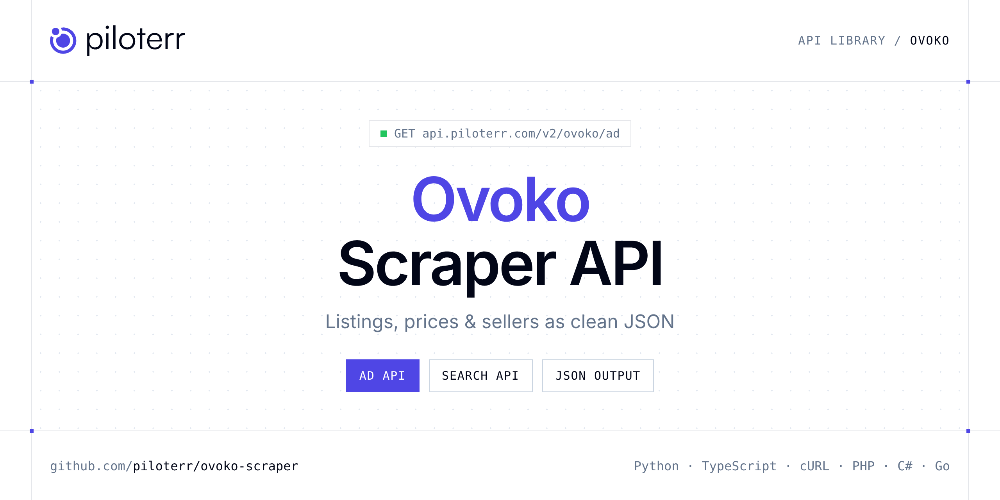

<p align="center">
  <a href="https://www.piloterr.com"></a>
</p>

# Ovoko Scraper API

[](https://discord.gg/CFj3ph8aHU) [](https://app.piloterr.com) [](https://app.piloterr.com/openapi) [](LICENSE)

The **Piloterr Ovoko Scraper API** lets you extract public data from Ovoko as **clean, structured JSON** — no proxies, headless browsers or HTML parsing to maintain. Endpoints available in production:

- **Ovoko Ad API** — Extract an Ovoko listing from a SKU URL: price, currency, images, seller, quality, vehicle make, part numbers, and warranty.
- **Ovoko Search API** — Search Ovoko used-parts listings from a search URL and retrieve title, price, OEM codes, seller, vehicle text, and pagination.

Use it for listing monitoring, price benchmarks, stock sourcing or market analytics on second-hand and vehicle marketplaces.

| Endpoint | Path | Credits | What you get |
|---|---|---|---|
| [Ovoko Ad API](#ovoko-ad-api) | `/v2/ovoko/ad` | 1 | Extract an Ovoko listing from a SKU URL |
| [Ovoko Search API](#ovoko-search-api) | `/v2/ovoko/search` | 1 | Search Ovoko used-parts listings from a search URL and retrieve title, price, OEM codes, seller, vehicle text, and pagination. |

## Table of contents

- [How it works](#how-it-works)
- [Ovoko Ad API](#ovoko-ad-api)
- [Ovoko Search API](#ovoko-search-api)
- [Code examples in other languages](#code-examples-in-other-languages)
- [Practical use cases](#practical-use-cases)
- [Why Piloterr?](#why-piloterr)
- [FAQ](#faq)
- [Related scrapers](#related-scrapers)
- [Support](#support)

## How it works

1. **Create a free Piloterr account** and copy your API key from the [dashboard](https://app.piloterr.com).
2. **Send a `GET` (or `POST`) request** to `https://api.piloterr.com/v2/...` with the header `x-api-key: YOUR_API_KEY`.
3. **Receive structured JSON** — Piloterr handles rendering, proxies, retries and parsing.

```bash
export PILOTERR_API_KEY="your-api-key"
pip install requests        # Python
# TypeScript: Node.js 18+ (native fetch), run with `npx tsx file.ts`
```

> Every endpoint accepts both `GET` (query string) and `POST` (JSON body with the same fields).

## Ovoko Ad API

Extract an Ovoko listing from a SKU URL: price, currency, images, seller, quality, vehicle make, part numbers, and warranty.

`GET | POST https://api.piloterr.com/v2/ovoko/ad` · **1 credit per request** · [Full reference](https://app.piloterr.com/openapi)

### Request parameters

| Parameter | Type | Required | Description |
|---|---|---|---|
| `query` | string | ✅ | Full Ovoko listing URL. The last path segment must be a SKU slug (example: `qbb17557-95c827460c-porsche-macan-...`) or a known product prefix. |

### Python example

```python
import json
import os
import requests

response = requests.get(
    "https://api.piloterr.com/v2/ovoko/ad",
    headers={"x-api-key": os.environ["PILOTERR_API_KEY"]},
    params={
        "query": "https://ovoko.fr/les-pieces/lgn634714-1780a036-mitsubishi-asx-filtre-d-habitacle",
    },
    timeout=120,
)
response.raise_for_status()
data = response.json()

print(json.dumps(data, indent=2, ensure_ascii=False)[:2000])
```

### TypeScript example

```typescript
type OvokoAd = {
  id?: string;
  rhd?: boolean;
  sku?: string;
  url?: string;
  sold?: boolean;
  price?: number;
  images?: string[];
  seller?: {
    name?: string;
  };
  status?: string;
  quality?: string;
  vehicle?: {
    make?: string;
  };
  category?: {
    name?: string;
  };
  currency?: string;
  discount?: number;
  position?: string;
  warranty?: unknown;
  attributes?: unknown[];
  part_number?: string;
  part_numbers?: string[];
  display_labels?: unknown[];
};

const params = new URLSearchParams({
  "query": "https://ovoko.fr/les-pieces/lgn634714-1780a036-mitsubishi-asx-filtre-d-habitacle",
});

const response = await fetch(`https://api.piloterr.com/v2/ovoko/ad?${params}`, {
  headers: { "x-api-key": process.env.PILOTERR_API_KEY! },
});
if (!response.ok) throw new Error(`Piloterr error ${response.status}: ${await response.text()}`);

const data = (await response.json()) as OvokoAd;

console.log(JSON.stringify(data, null, 2).slice(0, 2000));
```

<details>
<summary><b>POST variant</b></summary>

```http
POST https://api.piloterr.com/v2/ovoko/ad
x-api-key: YOUR_API_KEY
Content-Type: application/json

{"query": "https://ovoko.fr/les-pieces/lgn634714-1780a036-mitsubishi-asx-filtre-d-habitacle"}
```
</details>

### Output example

Example response from the API reference, abridged — real values depend on the page you scrape.

```json
{
  "id": "mth8663",
  "rhd": false,
  "sku": "mth8663",
  "url": "https://ovoko.pl/czesci-samochodowe/mth8663-8w0807437ab-audi-a4-s4-b9-zderzak-przedni",
  "sold": false,
  "price": 1690.01,
  "images": [
    "https://images.ovoko.com/bl/542x407/mth/0/0/0/0/0/8/6/6/3/c496a92f17dc1e839aebddf482037e83-audi_a4_s4_b9_front_bumper.jpg"
  ],
  "seller": {
    "name": "example"
  },
  "status": "IN_STOCK",
  "quality": "USED",
  "vehicle": {
    "make": "Audi"
  },
  "category": {
    "name": "Zderzak przedni"
  },
  "currency": "PLN",
  "discount": 75,
  "position": "FRONT",
  "warranty": null,
  "attributes": [],
  "part_number": "8W0807437AB",
  "part_numbers": [
    "8W0807437AB"
  ],
  "display_labels": []
}
```

### Response fields

| Field | Type | Description |
|---|---|---|
| `id` | string |  |
| `rhd` | boolean |  |
| `sku` | string |  |
| `url` | string |  |
| `sold` | boolean |  |
| `price` | number |  |
| `images` | string[] |  |
| `seller` | object |  |
| `seller.name` | string |  |
| `status` | string |  |
| `quality` | string |  |
| `vehicle` | object |  |
| `vehicle.make` | string |  |
| `category` | object |  |
| `category.name` | string |  |
| `currency` | string |  |
| `discount` | integer |  |
| `position` | string |  |
| `warranty` | object |  |
| `attributes` | any[] |  |
| `part_number` | string |  |
| `part_numbers` | string[] |  |
| `display_labels` | any[] |  |

## Ovoko Search API

Search Ovoko used-parts listings from a search URL and retrieve title, price, OEM codes, seller, vehicle text, and pagination.

`GET | POST https://api.piloterr.com/v2/ovoko/search` · **1 credit per request** · [Full reference](https://app.piloterr.com/openapi)

### Request parameters

| Parameter | Type | Required | Description |
|---|---|---|---|
| `query` | string | ✅ | Full Ovoko search URL. Only search pages are accepted (not category, catalog, or offer pages). |

### Python example

```python
import json
import os
import requests

response = requests.get(
    "https://api.piloterr.com/v2/ovoko/search",
    headers={"x-api-key": os.environ["PILOTERR_API_KEY"]},
    params={
        "query": "https://ovoko.pl/szukaj?q=Porsche+Macan+uszczelka+klapy+bagaznika&exact=1",
    },
    timeout=120,
)
response.raise_for_status()
data = response.json()

print(json.dumps(data, indent=2, ensure_ascii=False)[:2000])
```

### TypeScript example

```typescript
type OvokoSearch = {
  results?: {
    id?: string;
    url?: string;
    image?: string;
    price?: number;
    title?: string;
    seller?: {
      name?: string;
    };
    vehicle?: string;
    currency?: string;
    part_number?: string;
    part_numbers?: string[];
  }[];
  pagination?: {
    next?: string;
    page?: number;
    per_page?: number;
    total_pages?: number;
    total_results?: number;
  };
};

const params = new URLSearchParams({
  "query": "https://ovoko.pl/szukaj?q=Porsche+Macan+uszczelka+klapy+bagaznika&exact=1",
});

const response = await fetch(`https://api.piloterr.com/v2/ovoko/search?${params}`, {
  headers: { "x-api-key": process.env.PILOTERR_API_KEY! },
});
if (!response.ok) throw new Error(`Piloterr error ${response.status}: ${await response.text()}`);

const data = (await response.json()) as OvokoSearch;

console.log(JSON.stringify(data, null, 2).slice(0, 2000));
```

<details>
<summary><b>POST variant</b></summary>

```http
POST https://api.piloterr.com/v2/ovoko/search
x-api-key: YOUR_API_KEY
Content-Type: application/json

{"query": "https://ovoko.pl/szukaj?q=Porsche+Macan+uszczelka+klapy+bagaznika&exact=1"}
```
</details>

### Output example

Example response from the API reference, abridged — real values depend on the page you scrape.

```json
{
  "results": [
    {
      "id": "qbb17557",
      "url": "https://ovoko.pl/czesci-samochodowe/qbb17557-95c827460c-porsche-macan-95c-uszczelka-tylnej-klapy-bagaznika",
      "image": "https://images.ovoko.com/tr/fill/1024x768/qbb/0/0/0/0/1/7/5/5/7/6e97a74672da438c268a980449538b78-porsche_macan__95c__seal_rubber__tailgat…",
      "price": 200.01,
      "title": "Uszczelka tylnej klapy bagażnika",
      "seller": {
        "name": "example"
      },
      "vehicle": "Porsche Macan (95C)  2024  0cm3  0kW Manualna",
      "currency": "PLN",
      "part_number": "95C827460C",
      "part_numbers": [
        "95C827460C"
      ]
    }
  ],
  "pagination": {
    "next": "https://ovoko.pl/szukaj?q=Porsche+Macan+uszczelka+klapy+bagaznika&exact=1&page=2",
    "page": 1,
    "per_page": 15,
    "total_pages": 667,
    "total_results": 10000
  }
}
```

### Response fields

| Field | Type | Description |
|---|---|---|
| `results[]` | object[] |  |
| `results[].id` | string |  |
| `results[].url` | string |  |
| `results[].image` | string |  |
| `results[].price` | number |  |
| `results[].title` | string |  |
| `results[].seller` | object |  |
| `results[].vehicle` | string |  |
| `results[].currency` | string |  |
| `results[].part_number` | string |  |
| `results[].part_numbers` | string[] |  |
| `pagination` | object |  |
| `pagination.next` | string |  |
| `pagination.page` | integer |  |
| `pagination.per_page` | integer |  |
| `pagination.total_pages` | integer |  |
| `pagination.total_results` | integer |  |

## Code examples in other languages

Ready-to-run examples live in the [`examples/`](examples) folder. Each one reads your key from the `PILOTERR_API_KEY` environment variable.

| Language | Ad | Search |
|---|---|---|
| cURL (Bash) | [`ad`](examples/curl/ad.sh) | [`search`](examples/curl/search.sh) |
| PHP | [`ad`](examples/php/ad.php) | [`search`](examples/php/search.php) |
| C# | [`ad`](examples/csharp/Ad.cs) | [`search`](examples/csharp/Search.cs) |
| Go | [`ad`](examples/go/ad.go) | [`search`](examples/go/search.go) |
| Java | [`ad`](examples/java/AdExample.java) | [`search`](examples/java/SearchExample.java) |
| Ruby | [`ad`](examples/ruby/ad.rb) | [`search`](examples/ruby/search.rb) |
| Node.js | [`ad`](examples/nodejs/ad.mjs) | [`search`](examples/nodejs/search.mjs) |

## Practical use cases

- **Listing monitoring** — Get alerted when new ads matching your criteria are published.
- **Price benchmarks** — Compute market prices per model, category or location.
- **Sourcing** — Find stock, vehicles, parts or equipment faster than manual browsing.
- **Market analytics** — Measure supply, turnover and pricing trends over time.
- **Data products** — Feed valuation models and dashboards with structured listings.

## Why Piloterr?

- **No infrastructure** — no proxies, headless browsers or CAPTCHA solving to run yourself.
- **Structured JSON** — stable, documented fields instead of brittle HTML selectors.
- **Pay per request** — transparent credit cost per endpoint, failed requests are retried for you.
- **One API key, hundreds of sources** — Ovoko plus many other e-commerce, search and company data endpoints in the [Piloterr library](https://www.piloterr.com/library).
- **Any language** — plain HTTPS + JSON, with examples for Python, TypeScript, cURL, PHP, C#, Go, Java, Ruby and Node.js.

## FAQ

### Is it legal to scrape Ovoko?

Collecting publicly available data is generally allowed in many jurisdictions, but rules depend on your country, the data you collect and how you use it. Avoid personal data unless you have a lawful basis, respect the website's terms where they apply, and get legal advice for your specific use case. This is not legal advice.

### Do I need proxies or a headless browser?

No. Piloterr handles rendering, proxy rotation and retries on its side. You only send an HTTPS request with your `x-api-key` header and receive JSON.

### How much does a request cost?

Credits per call: `/v2/ovoko/ad` **1**, `/v2/ovoko/search` **1**. See the [Piloterr website](https://www.piloterr.com) for plans.

### What data does the Ovoko API return?

Each endpoint returns structured JSON: **Ovoko Ad** — `id`, `rhd`, `sku`, `url`, `sold`, `price`; **Ovoko Search** — `results[]`, `results[].id`, `results[].url`, `results[].image`, `results[].price`, `results[].title`.

### Which languages are supported?

Any language that can make an HTTP request. This README shows Python and TypeScript; the [`examples/`](examples) folder contains cURL, PHP, C#, Go, Java, Ruby and Node.js.

## Related scrapers

- [AutoScout24 Scraper API](https://github.com/piloterr/autoscout24-scraper)
- [Autotrader Scraper API](https://github.com/piloterr/autotrader-scraper)
- [Copart Scraper API](https://github.com/piloterr/copart-scraper)
- [Kijiji Scraper API](https://github.com/piloterr/kijiji-scraper)
- [Leboncoin Scraper API](https://github.com/piloterr/leboncoin-scraper)
- [Mascus Scraper API](https://github.com/piloterr/mascus-scraper)
- [All Piloterr scrapers on GitHub](https://github.com/piloterr)

## Support

- 💬 Join the [Piloterr Discord](https://discord.gg/CFj3ph8aHU) to ask questions and share what you build.
- 📚 Browse the [API reference (OpenAPI)](https://app.piloterr.com/openapi) and the [Piloterr library](https://www.piloterr.com/library).
- 🔑 [Get your API key](https://app.piloterr.com).

---

<p align="center">
  <a href="https://www.piloterr.com">
    <picture>
      <source media="(prefers-color-scheme: dark)" srcset="images/logo-dark.svg">
      
    </picture>
  </a>
  <br>
  <sub>Built by <a href="https://www.piloterr.com">Piloterr</a> — web scraping APIs for e-commerce, search, real estate and more, one API key.</sub>
</p>

<sub>Ovoko is a trademark of its respective owner. This repository is not affiliated with or endorsed by Ovoko. Examples are released under the MIT license.</sub>
